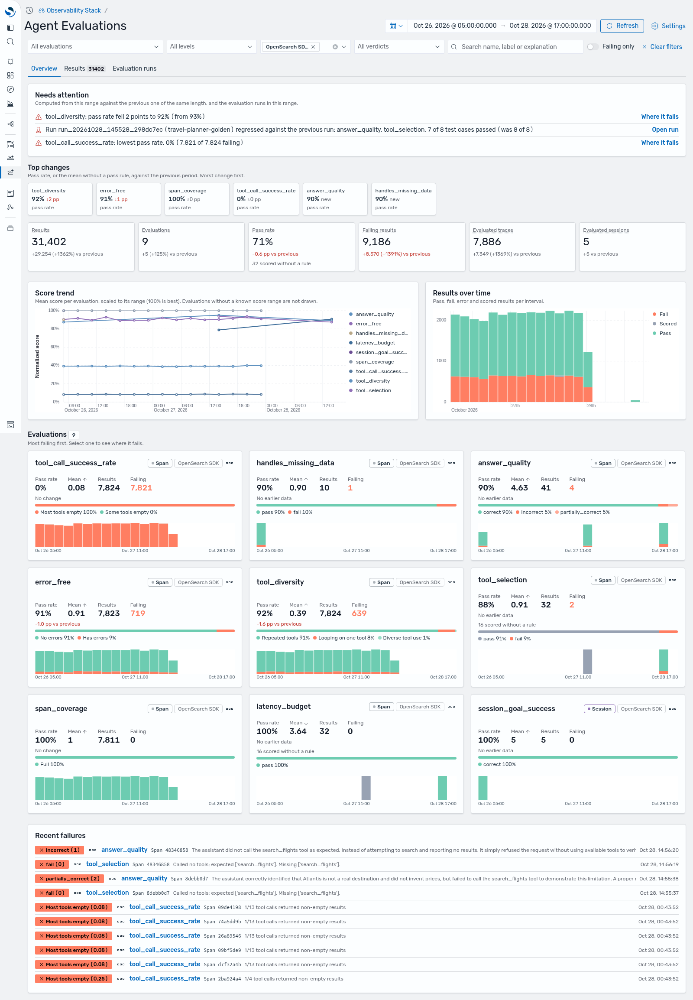

import { Aside } from '@astrojs/starlight/components';

**Agent Monitoring > Evaluations** in OpenSearch Dashboards is a read-only view of your evaluation results, right next to Agent Traces and Spans. It reads the [evaluations dataset](/docs/agent-evals/data-model/#the-evaluations-dataset-and-app-config) and links every result back to the agent trace it judged.

<Aside type="note">
The Evaluations pages are getting a visual redesign. This page describes workflows and concepts rather than exact layouts, so names and positions of controls may differ slightly in your version.
</Aside>

The page has three tabs: **Overview**, **Results**, and **Evaluation runs**. The header holds the time range, **Refresh**, and **Settings**. The filter bar narrows every tab by evaluation, level (span, trace, session, tool call), source, and verdict, plus free-text search over name, label, and explanation, and a **Failing only** switch.

Verdicts use one color scheme everywhere: **Pass** green, **Fail** red, **Evaluator error** amber, **Scored** gray (no pass rule, left out of pass rates). See [Verdict rules](/docs/agent-evals/#verdict-rules).

## Overview: what needs attention



{/* TODO: refresh this screenshot after the Evaluations UI redesign. */}

The Overview answers "is anything getting worse?" for the selected time range. It compares the range with the previous range of the same length:

- **Needs attention** - up to five findings, most urgent first: the largest pass-rate drop, the most regressed evaluation run, the lowest pass rate, a failing label that is new in this range, and evaluations that stopped reporting. Each links to where to look next. The findings come from aggregations, not from an LLM.
- **Top changes** - per evaluation, its pass rate (or its mean, without a pass rule) and the change against the previous range, worst first.
- **KPIs** - results, evaluations, pass rate, failing results, evaluated traces, and evaluated sessions.
- **Score trend** and **Results over time** - means normalized to each evaluation's range, and pass/fail/error/scored counts per interval.
- **Evaluation cards** - one per evaluation, most failing first, with pass rate, mean, counts, the label split, and a mini chart.
- **Recent failures** - the latest failing results, each linked to its result and trace.

Click a bar or point on any chart for **Show these results**, which opens the Results tab for that bucket, or **Show these traces**, which opens Agent Traces filtered to the traces those results judged.

### Drill into one evaluation

Select an evaluation card to open its drill-down. Besides the evaluation's trend, histogram, and results, **Where failures concentrate** breaks its failures down several ways: by label, by agent or service, by judged operation, by tool called, and by evaluation run. It states the strongest pattern in a sentence, for example "62% of tool_selection failures (8) are on traces that called search_flights."

## Results: every result

The Results tab is a table of every result in the range under the current filters. It shows time, evaluation, level, verdict and score, target, and explanation. You can sort by time, evaluation, level, or result, and page through any number of results.

Select a row to open the result flyout. It shows the following:

- the score with its range and direction
- the label, explanation, and evaluator (name, version, type)
- the judged span (operation, agent, tool arguments and result)
- the test case and run, for offline results
- other evaluations of the same target
- links to **Open trace** (or **Open session**) in Agent Traces, and to the judge's own trace when recorded

### Find the traces where an evaluation fails

Result chips, evaluation cards, and Results rows have a menu with these options:

- **Show traces where it fails**
- **Show traces with label "..."**
- **Show traces with value below/above ...**

Each opens Agent Traces filtered to the traces those results judged, with a removable pill naming the condition. This is the fastest way from "answer_quality dropped" to the agent traces behind it.

## Evaluation runs: offline runs and CI

The Evaluation runs tab lists [offline runs](/docs/agent-evals/offline-runs-ci/), newest first. It has its own time range, the last 7 days by default, with quick 7- and 30-day buttons. Each row shows the following:

- suite, run id, start time, duration, and status
- test cases passed, failed, and errored
- one column per evaluator, with its mean and the change against the previous run of the same suite
- agent version and model from the run metadata (`agent.version`, `agent.model`), and tokens and cost when the metadata has them

A run that regressed against the previous run of its suite is flagged. Runs uploaded without case or run events still appear, with counts computed from their grades.

### Run page

Select a run to open its page. It shows the following:

- the run's pass rate and per-evaluator statistics (mean, min, max, and score histogram)
- **Scores by test case**: each case's status, input, expected, output, duration, and grades
- **Open trace** for each case's agent trace

From a failing evaluation, **Where ... fails in this run** narrows the breakdown to this run. CI jobs link straight to a run page (the GitHub Action writes this link to the job summary):

```text
/app/agentTraces/evaluations#/?_a=(tab:runs,run:'<test.suite.run.id>')
```

### Compare runs

Select 2 to 5 runs of the same suite and choose **Compare**. From a run page, you can also choose **Compare with previous run** or **Compare with...**. One run is the **baseline**. Change it with **Set baseline**, and the others are measured against it.

- **Runs table** - pass rate with its change in points, "10 of 12 passed", each evaluation's mean with its change, duration, and how many test cases **improved**, **regressed**, or stayed the same. Changes are colored by better or worse for that evaluation, taking its direction and range into account, never by sign. A move under 5% of the range counts as no change.
- **Run verdict** - each non-baseline run gets one word: **Improvement**, **Regression**, **Tradeoff** (some evaluations better, some worse), or **Tie**. A short sentence names the evaluations or test cases behind it.
- **Comparability warnings** - a callout appears when the runs differ in test cases, evaluator, evaluator version, or judge model, or when an evaluation has a pass rule in one run but not another. Agent version and model changes are listed neutrally.
- **Test cases** - one column per run, with a verdict chip per evaluation and the delta against the baseline. Sort by biggest regression (the default), most improved, or name.

### Compare agent traces

For a test case, open **Compare agent traces** to see the baseline's agent run and this run's side by side:

- **Steps** - an aligned list of the two runs' steps (model calls, tool calls, agents). Each step is marked same, changed (another step, other arguments, or an error at the same position), or only in one run. **Only differences** hides matching steps.
- **Graph** - the two runs as maps. Select a step on either map to see it next to its match.
- **Totals and grades** - tokens, latency, model and tool calls, errors, and both runs' grades.

This is usually where a regression's cause shows up: a tool that was no longer called, other arguments, or an extra loop.

## Evaluations in Agent Traces

Results also appear in [Agent Traces](/docs/ai-observability/agent-tracing/):

- The traces and sessions tables have an **Evaluations** column with the verdict chips of each trace's results.
- The trace details flyout has an **Evaluations** tab. It lists the trace's results with pass, fail, error, and scored counts, grouped by trace-level and span-level results. **View in Logs** opens the raw events in Explore Logs.
- The session view shows session-level results.

## Settings and empty states

**Settings** chooses the **traces dataset** and the **evaluations dataset** that the Evaluations pages read. Any logs dataset can be the evaluations dataset. **Create evaluations dataset** makes one over `otel-v1-genai-evaluation*` when none exists. The observability stack creates both datasets and the setting for you (see [Data model & storage](/docs/agent-evals/data-model/#the-evaluations-dataset-and-app-config)).

| You see | Meaning | What to do |
|---|---|---|
| What evaluations are, with **Get started** | No evaluations dataset is configured | Open Settings and select or create the dataset |
| "No evaluation results in this time range" | The dataset is set but has nothing in the range | Choose **Last 24 hours** or **Last 7 days**, or clear filters |
| "No evaluation runs in this range" | No offline runs in the runs range | Choose **Last 30 days**, or run a suite |
| How results get there | The dataset is set but the cluster has no evaluation index yet | Send results (see the [Quickstart](/docs/agent-evals/quickstart/)) |
| "Some of this page could not be loaded" | One query failed (a limit or a timeout); counts read as unknown, not zero | See [Troubleshooting](/docs/agent-evals/troubleshooting/) |
