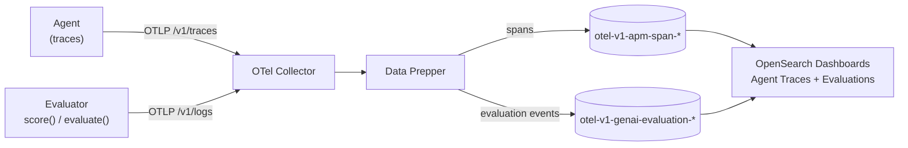

**Agent Evals** measure whether your AI agents are doing a good job: not just whether they ran, but whether their answers are correct, their tool calls are right, and they stay within budget. [Agent Observability](/docs/ai-observability/) shows you *what an agent did* (traces, spans, the execution graph). Agent Evals put a **verdict and a score** on that behavior so you can track it over time, compare agent versions, and catch regressions before they ship.

Every evaluation result is a standard OpenTelemetry **log event** named `gen_ai.evaluation.result` ([GenAI semantic conventions](https://opentelemetry.io/docs/specs/semconv/gen-ai/gen-ai-events/)). The event carries the trace and span id of the agent step it judges, so it joins to that trace without adding spans to it. Results travel over OTLP logs, Data Prepper routes them to their own index (`otel-v1-genai-evaluation-*`), and **Agent Monitoring > Evaluations** in OpenSearch Dashboards shows them next to the agent traces.

## Core concepts

| Term | Meaning |
|---|---|
| **Evaluation result** (grade) | One judgment of one target: a name (`gen_ai.evaluation.name`), an optional numeric score, an optional label, an explanation, and an optional verdict. One `gen_ai.evaluation.result` event. |
| **Evaluator** | Whatever produced the result: an LLM judge, a code check, a human reviewer, or an external tool. Recorded as the event's instrumentation scope and `opensearch.evaluation.evaluator.name`. |
| **Level** | What was judged: a single `span`, a whole `trace`, a `session` (multi-turn conversation), or a `tool_call`. |
| **Test suite** | A named, stable set of test cases (`test.suite.name`), for example `checkout-agent-golden`. |
| **Evaluation run** | One execution of a suite (`test.suite.run.id`). Each test case runs the agent once, as its own trace, and gets a pass, fail, or error status. |
| **Verdict** | Pass, Fail, Evaluator error, or **Scored** (a score with no pass rule). |

## Online and offline evaluation

The same event shape covers both ways of evaluating an agent:

- **Online** - score production (or staging) traffic as it happens or shortly after. Call `score()` inline while the agent runs, or run a background job that reads recent traces and writes results for them. The stack's eval canary does this with deterministic checks.
- **Offline** - run the agent against a fixed dataset of test cases, score every output, and compare the run with earlier runs. `evaluate()` does this in one call and is what you run in CI. In addition to the per-score events, an offline run emits one `opensearch.test_case.result` event per test case and one `opensearch.test_suite_run.result` event per run. That is what powers the **Evaluation runs** and **Compare** views.

In both cases the agent's own trace is unchanged: the SDK adds no harness spans around it. In an offline run, the agent's root span is stamped with the `test.*` ids so the trace and its test case find each other.

## Verdict rules

A pass/fail verdict comes only from a rule someone declared. A plain number, or a label that happens to say "pass", is not a verdict. OpenSearch Dashboards applies these rules in order, and the first that decides wins:

1. **Evaluator error** - `error.type` is set (the evaluator itself failed, so there is no verdict).
2. **Producer assessment** - `opensearch.evaluation.assessment` is `pass` or `fail`.
3. **Producer threshold** - `opensearch.evaluation.score.threshold` with `opensearch.evaluation.score.direction`: with `maximize` (the default), values at or above the threshold pass; with `minimize`, values at or below it pass.
4. **Built-in rules** for a few known third-party evaluators.
5. Otherwise **Scored**: shown in gray, with its mean or top label, and left out of pass rates.

The SDKs declare rules for you. Pass `threshold=` or `assessment=` to `score()`, or decorate a scorer with `@scorer(threshold=...)`. When a value and a threshold are given, the SDK also records the computed assessment. See [Instrument evaluations](/docs/agent-evals/instrumenting/#declaring-verdicts).

A test case's status follows the same rules on the producer side: `error` if the agent or a scorer raised, else `fail` if any of its scores has a `fail` verdict, else `pass`.

## In this section

- **[Quickstart](/docs/agent-evals/quickstart/)** - start the stack, run a sample suite with a mock agent (no model API key), and open the results.
- **[Instrument evaluations](/docs/agent-evals/instrumenting/)** - `score()`, `@scorer` / `defineScorer`, `evaluate()`, `Benchmark`, and the traces and logs endpoints.
- **[Offline runs & CI](/docs/agent-evals/offline-runs-ci/)** - run a suite on every pull request with the GitHub Action, link the run, and gate on regressions.
- **[Data model & storage](/docs/agent-evals/data-model/)** - event attributes, the evaluation index, derived fields, and the evaluations dataset.
- **[Evaluations UI](/docs/agent-evals/evaluations-ui/)** - Overview, Results, Evaluation runs, Compare, and evaluations in Agent Traces.
- **[Troubleshooting & limits](/docs/agent-evals/troubleshooting/)** - missing results, "Scored" instead of pass/fail, mapping and paging limits.
- **[Evaluation integrations](/docs/agent-evals/evaluation-integrations/)** - bring DeepEval, RAGAS, MLflow, and pytest results in with `Benchmark`.

## Related

- [Agent Observability](/docs/ai-observability/) - trace and visualize agent execution, the data your evaluations judge.
- [Send Data: AI Agents](/docs/send-data/ai-agents/) - instrument an agent so its traces reach the stack.
- [Agent Health](/docs/agent-health/) - a local tool for Golden Path trajectory comparison and LLM-judge experiments.
